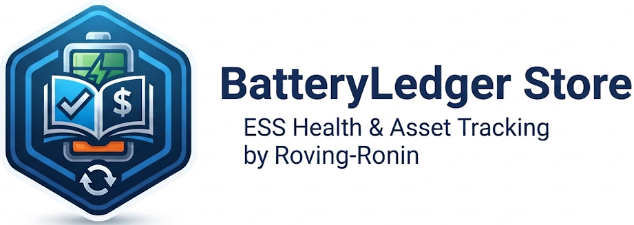

<p align="center"></p>

##

Community library of home battery specifications and warranty terms, used by the
[BatteryLedger](https://github.com/Roving-Ronin/BatteryLedger) Home Assistant integration.

- **Browse:** https://roving-ronin.github.io/BatteryLedger-Store/
- **Index used by the integration:** https://roving-ronin.github.io/BatteryLedger-Store/index.json

## Contributing a battery

**From Home Assistant (easiest):** in BatteryLedger choose *Enter manually*, then *Submit to Store*.
You can sign in with GitHub from inside Home Assistant, or open a pre-filled form in your browser.

**From GitHub:** open a [Battery spec submission](../../issues/new?template=spec-submission.yml) issue.

Either way an Action checks the submission. If it's valid it opens a pull request, and if it isn't it
comments on the issue explaining what to fix (edit the issue and it re-checks). A maintainer compares
the figures with the linked manufacturer documents before merging.

Please use the **manufacturer's datasheet and warranty for your region**: warranty throughput and
capacity figures often differ between countries. Submissions are public, so only include product
specifications, never your install date, cost, serial numbers or energy totals.

To correct an existing battery, use the same form and put its spec ID (shown in the Store and in
BatteryLedger) in *Existing spec ID*.

## Spec format

One JSON file per product and region group: `specs/<brand>/<id>.json`, validated against
[`schema/battery-spec.schema.json`](schema/battery-spec.schema.json).

| Field | Meaning |
|---|---|
| `id` | `<brand>-<model>[-<variant>]-<region group>`, e.g. `sigenergy-sigenstor-bat-8-0-anz` |
| `spec_version` | Starts at 1 and goes up with every approved change, so installs can spot revisions |
| `series` | Model (product line) within the brand, e.g. `SigenStor` or `Neo`: the Model filter |
| `model` | Battery module or unit, e.g. `SigenStor BAT 8.0` |
| `regions` | Country codes (`AU`, `NZ`, ...) or `GLOBAL` |
| `phases` | `["1"]`, `["3"]` or `["1", "3"]` |
| `capacity.unit` | `module` (stackable; figures are per module) or `system` (all-in-one) |
| `capacity.usable_kwh` | Warranted usable energy per unit at beginning of life |
| `capacity.reported_kwh` | Capacity the inverter reports per unit (used to validate the configured count) |
| `warranty.eol_capacity_pct` | Capacity warranted at end of warranty, e.g. `70` |
| `warranty.throughput.basis` | `charged`, `discharged` or `unspecified` if the warranty doesn't say |
| `warranty.throughput.scope` | `per_unit`, `per_system`, `table` (limit depends on unit count) or `none` |
| `verified` | Set by a maintainer after checking against the sources |

## Sensor profiles

`profiles/<id>.json` ([schema](schema/sensor-profile.schema.json)) describe how to find BatteryLedger's
sensors among the entities one Home Assistant integration creates, so setup can fill them in automatically.
Sensors are matched by their **entity registry unique ID**, never by entity ID (people rename entities).

| Field | Meaning |
|---|---|
| `integration.platform` | Entity registry platform: the integration domain (e.g. `sigen`) or `mqtt` |
| `brands` | Battery brands the profile applies to |
| `roles.<role>` | Matching rules in order of preference, each with a `level` (`plant`, `inverter` or `module`), a `unique_id` template (used for matching) and `default_entity_ids` (the entity IDs the integration creates by default, newest first; shown on the Store site) |

Roles:
- **Sensors:** `discharged_energy`, `charged_energy`, `rated_capacity`, `soh`, `soc` (the whole battery's state of
  charge, used to measure usable capacity), and per-module
  `module_discharged_energy`, `module_charged_energy`, `module_rated_capacity`, `module_soc`, `module_soh`.
- **Suggesting the battery** (setup's *Detect*): `module_count` and `tower_count`, and per inverter (level
  `inverter`, every match kept) `inverter_model`, `inverter_pack_count`, `inverter_rated_capacity` and
  `pack_serial` (one rule per pack position; positions with a serial count as installed, the serial is never
  stored; a rule's optional `tower` says which battery tower on the inverter the position is in, so Detect can
  offer a battery group per tower). `brand` names the system's brand; its rule's `values` map each state to the battery brands it can mean
  (e.g. Energy Manager's `fronius` → Fronius, BYD).
- **`unavailable`** (optional, beside `roles`): sensors the integration has a rule for but can't provide for some
  battery brands, e.g. `"unavailable": {"soh": ["Huawei", "iStore"]}` for Huawei Solar, where SoH only comes from
  a SmartLogger. The integration's card then says the sensor isn't available from that integration, instead of
  asking the user to set it up.
- **Pre-filling setup:** `install_date`, `install_cost` (first battery group), `install_date_2`, `install_cost_2`
  (batteries added later). A rule's `platform` names a helper's platform (`input_datetime`, `input_number`,
  `input_select`); helpers set up in YAML have their ID as unique ID.

Templates use placeholders for the parts that differ between installs, so no profile ever contains a
setup ID, station ID or serial number: `{entry}`, `{device}`, `{prefix}`, `{plant}`, `{inverter}`,
`{station}`, `{serial}`, `{mac}` (an ESPHome device's MAC address). Module templates must contain `{serial}`.

Seeded profiles: TypQxQ's [Sigenergy Local Modbus](https://github.com/TypQxQ/Sigenergy-Local-Modbus)
(`sigen`) and [sigenergy2mqtt](https://github.com/seud0nym/sigenergy2mqtt) (`mqtt`, including the optional
Sigen Cloud per-module sensors).

## Wanted sensor profiles

Integrations with home batteries that don't have a sensor profile yet. A profile needs the integration's
lifetime battery charge and discharge counters, and where it has them rated capacity, state of health and
state of charge, with `unique_id` templates taken from the integration's source code (see Sensor profiles above).

| Brand | Home Assistant integration |
|---|---|
| Growatt | `growatt_server` (cloud), Growatt local / Modbus |
| Sofar | Solarman, SolaX Modbus |
| SolaX | SolaX Modbus |
| Victron | Victron (GX / Modbus) |
| GivEnergy | GivEnergy Local |
| Fox ESS | Fox ESS Modbus |
| Solis | Solis Modbus |
| SolarEdge | SolarEdge Modbus Multi |
| Tesla Powerwall | Tesla Fleet / Teslemetry / Powerwall |
| Enphase IQ Battery | Enphase Envoy |
| EcoFlow | EcoFlow |

Until a profile exists, BatteryLedger can still find the battery's counters from Home Assistant's Energy
dashboard. (List based on the integrations Energy Pilot, MIT licensed, supports.)

## Maintainer notes

```bash
pip install -r scripts/requirements.txt pytest
python scripts/validate.py        # check every spec
python scripts/build_index.py _site
python -m pytest -q tests
```

Repository settings this needs:

- **Pages:** Settings → Pages → Source: *GitHub Actions*.
- **Actions:** Settings → Actions → General → Workflow permissions: allow *Read and write* and
  tick *Allow GitHub Actions to create and approve pull requests*.
- **Labels:** `spec-submission` and `needs-changes`.
- Issues opened without a template are closed automatically, and `/reopen` lets a reporter reopen their own
  issue. Spec submissions are exempt; the submission Action handles them.
- Pull requests opened by the submission Action don't trigger other workflows (a GitHub rule for
  `GITHUB_TOKEN`), which is why it validates the whole Store itself before opening one.
